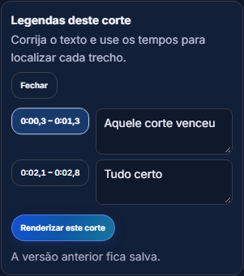

  

<h1 align="center">SharpClips AI</h1>

<strong>Transforme vídeos longos em cortes prontos para compartilhar.</strong>

Cortes automáticos, edição, legendas e tradução com IA no seu PC. Gratuito, sem assinatura.

  <a href="https://sharpclipsai.com.br/">Site oficial</a> ·
  <a href="https://sharpclipsai.com.br/#demonstracao">Demonstrações</a> ·
  <a href="https://github.com/alebcon12-eng/SharpClipsAI/releases/latest">Versão estável</a> ·
  <a href="https://github.com/alebcon12-eng/SharpClipsAI/issues">Reportar um problema</a>

## Baixar para Windows

- [**Instalador offline**](https://github.com/alebcon12-eng/SharpClipsAI/releases/download/4.3.2/SharpClipsAI_Setup_4.3.2_Offline_Windows_x64.exe) · **745 MB**. Traz Python, bibliotecas, FFmpeg, Microsoft Visual C++ e o instalador autônomo do WebView2. Use o mesmo arquivo para instalar em outros computadores.

- [**Instalador leve**](https://github.com/alebcon12-eng/SharpClipsAI/releases/download/4.3.2/SharpClipsAI_Setup_4.3.2_Windows_x64.exe) · **15 MB**. Reaproveita componentes compatíveis e baixa as dependências que faltam durante a instalação.

Os dois instaladores são da versão **4.3.2**, para **Windows 10 ou 11 de 64 bits**. Ambos precisam de internet para baixar os modelos de IA pela primeira vez. O espaço em disco depende dos modelos. Reserve **35 GB** para a configuração medida com Parakeet, Qwen com CUDA, Ollama para tradução, componentes e caches, além do espaço para seus vídeos e cortes. A aceleração CUDA requer uma GPU NVIDIA compatível. [Requisitos no site oficial](https://sharpclipsai.com.br/#requisitos)

## Primeiro corte

1. Em **Início → Central de IA**, selecione um perfil e clique em **Preparar IA**. Aguarde a confirmação **Você já pode criar cortes**.
2. Em **Criar cortes**, escolha um arquivo do PC, um vídeo da biblioteca ou cole um link disponível.
3. Defina o trecho, a duração, a quantidade e o formato. Em **Aparência**, escolha as legendas e os elementos visuais. Confira a prévia e inicie o processamento.
4. Em **Meus cortes**, assista aos resultados, corrija ou aprove cada corte e baixe os MP4s. Envie os aprovados ao YouTube em **Publicações**, quando o canal estiver conectado.

**Nesta página** · [Importação e NEXUS](#importação-e-nexus) · [Cortes automáticos](#cortes-automáticos) · [Legendas e tradução](#legendas-e-tradução) · [Enquadramento e identidade](#enquadramento-e-identidade) · [Biblioteca e revisão](#biblioteca-e-revisão) · [Editor Pro](#editor-pro) · [YouTube Shorts](#youtube-shorts) · [Central de IA](#central-de-ia) · [Configurações e suporte](#configurações-e-suporte)

## Importação e NEXUS

- **Arquivo do PC** — selecione ou arraste até cinco vídeos MP4, MOV, MKV ou M4V de uma vez. Você pode registrar o criador e o link da fonte para manter os créditos.
- **Biblioteca** — use um vídeo já importado, assista ao material original ou volte a processá-lo com configurações diferentes.
- **Links** — cole o endereço de um vídeo em **Criar cortes**. Para mais opções, abra **Configurações → Ferramentas avançadas → NEXUS Downloader**.
- **NEXUS Downloader** — analise links e páginas públicas compatíveis. Confira os formatos e resoluções que a fonte oferece, escolha vídeo ou áudio e salve o arquivo ou importe o vídeo para cortes. Há prévia quando disponível, fila, histórico, progresso, cancelamento, nova tentativa, verificação de formatos, cache e diagnóstico do download. A disponibilidade depende do site de origem. Use conteúdo que você tenha permissão para salvar e editar.

## Cortes automáticos

- **Seleção local de trechos** — o aplicativo analisa fala, áudio e sinais da fonte para sugerir momentos com potencial de corte. A revisão mostra a nota e os sinais considerados quando há evidência suficiente.
- **Linha do tempo com o vídeo aberto** — analise o vídeo inteiro ou limite a busca a um intervalo. Navegue pelo original, marque início e fim no quadro atual e refine os tempos manualmente.
- **Quantidade e duração** — escolha quantidade automática ou defina um limite. Use as durações-alvo de aproximadamente 15, 30 ou 60 segundos ou informe uma duração personalizada. A quantidade final depende dos trechos elegíveis.
- **Formatos** — vertical **9:16** (1080 × 1920), quadrado **1:1** (1080 × 1080) ou horizontal **16:9** (1920 × 1080) no fluxo de criação de cortes.
- **Diretor de IA** — ajuste o objetivo editorial, a intensidade e a quantidade-alvo para as próximas análises. O Ollama pode ajudar na seleção e na redação de títulos e descrições quando preparado e habilitado.
- **Progresso e tarefas** — acompanhe a etapa de processamento, abra os detalhes, cancele ou retome trabalhos pendentes na Central de tarefas. Um som breve avisa quando o lote de cortes termina.

## Legendas e tradução

- **Transcrição automática no computador** — selecione o idioma falado ou use a detecção automática. Mantenha o idioma original ou traduza por frases com um modelo local do Ollama. Português, inglês, espanhol, francês, alemão e italiano estão disponíveis separadamente como idiomas de fala e de saída.
- **15 estilos de legenda** — Karaokê clássico, Karaokê progressivo, Pop, Explosão, Neon, Minimal, Caixa, Marca-texto, Editorial, Cinematográfico, Bold, Shorts e Reels, Podcast, Gamer e Palavra central. Os cartões deixam comparar os movimentos e a prévia FFmpeg mostra o resultado no quadro inteiro.
- **Personalização** — ajuste fonte, tamanho, cor do texto, cor de destaque e posição. No **Estúdio de Legendas**, ajuste também peso, contorno, sombra, movimento, sincronização e palavras por grupo. Use fontes do Windows ou adicione fontes TTF, OTF ou TTC.
- **Presets** — guarde uma configuração de legenda para reutilizar, aplicar a um projeto ou vincular a um canal. Em **Criar cortes**, você pode salvar o visual para os próximos cortes do canal.
- **Vídeo inteiro** — abra o Estúdio de Legendas pelo Editor Pro ou pelo atalho **Tarefas → Transcrições de vídeo**. Transcreva uma mídia inteira da biblioteca, acompanhe o progresso e use a mídia transcrita em uma montagem.
- **Correção por corte** — use **Editar legendas** para saltar pelo tempo até a fala, corrigir o texto ou pedir uma nova transcrição para aplicar sugestões. **Renderizar este corte** cria uma nova versão só daquele vídeo e atualiza título, descrição e hashtags com base no contexto do corte inteiro, incluindo as correções. A versão anterior continua na biblioteca. Os detalhes indicam situações como legenda parcial, motor alternativo e motivo de falha.

## Enquadramento e identidade

- **Composição do vídeo** — ajuste o quadro inteiro ou, em 9:16, combine conteúdo e facecam. Use a detecção de região, selecione manualmente ou mantenha apenas o vídeo. Controle posição, zoom e encaixe. Quando a região automática não é confiável, o aplicativo preserva o vídeo inteiro.
- **Tela dividida e segmentos** — monte o quadro superior e inferior a partir de regiões do original, ajuste a divisão e a ordem e salve enquadramentos diferentes por trecho.
- **Logo do canal** — importe PNG, JPG ou WEBP e escolha canto ou posição livre, tamanho e opacidade. A logo é opcional. Créditos podem aproveitar o criador e a fonte registrados.
- **Arte final própria** — use PNG, JPG, WEBP, MP4 ou GIF do PC. Personalize título, agradecimento, mensagem e logo, com ajuste de posição, tamanho, encaixe, duração e transição. Você pode renderizar uma prévia dos segundos finais, usar só a arte ou exportar sem encerramento.
- **Prévia** — use o vídeo original para escolher o ponto e gere a prévia pelo FFmpeg. Amplie para conferir enquadramento, legenda, marca e créditos antes de exportar.

## Biblioteca e revisão

- **Meus vídeos** — reabra o vídeo original ou o link da fonte, consulte o histórico de importações, associe vídeos a criadores, gere cortes novamente e apague vídeos ou seleções com confirmação. Apagar o original mantém os cortes já renderizados.
- **Meus cortes** — assista ao MP4, pesquise por título, criador ou ID, filtre por estado, vídeo de origem ou criador e confira revisões, tempos, duração e informações de análise.
- **Criadores** — registre nome e identificador, associe cortes em lote e organize o acervo por canal. Você também pode remover um criador da lista e restaurá-lo.
- **Ajustar corte** — reveja o vídeo e mude início, fim, formato e visual. A nova versão reaproveita a faixa analisada compatível. Em **Enquadrar**, ajuste a composição por segmento.
- **Encurtar pausas** — analise pausas em três intensidades, assista à prévia, selecione quais intervalos encurtar e exporte uma nova revisão. As pausas também podem ser restauradas.
- **Revisão editorial** — edite título, descrição e hashtags ou copie a descrição. Confira direitos e conteúdo do vídeo antes de aprovar ou rejeitar. Os aprovados ficam disponíveis na seleção de Publicações.
- **Exportação e limpeza** — baixe um MP4 ou agrupe cortes selecionados em ZIP. Apague cortes com confirmação sem remover a gravação original.

## Editor Pro

- **Projetos e exportações** — crie uma montagem com vídeos originais e cortes da biblioteca, salve o projeto, reabra-o e baixe as exportações no acervo de projetos.
- **Timeline** — escolha os limites de cada clipe, divida na posição atual, mude a ordem, remova trechos, ajuste o zoom da timeline e silencie o áudio de um trecho. Há comandos para desfazer e refazer, salvar e vincular novamente um arquivo de mídia.
- **Edição pelo texto** — com análise disponível, salte até falas pelos tempos da transcrição, selecione o texto para retirar o intervalo correspondente e consulte as sugestões da Central de cortes.
- **Acabamento** — ajuste enquadramento, use presets do Estúdio de Legendas, confira um quadro renderizado e edite título, descrição, hashtags e créditos da montagem.
- **Exportação** — use a prévia leve para navegação e o quadro FFmpeg para conferir a legenda. Exporte MP4 vertical **720 × 1280** ou horizontal **1280 × 720** pelo Editor Pro, com progresso, cancelamento e opção de retomar a exportação.

## YouTube Shorts

- **Conectar com Google** — autorize seu canal no navegador pelo botão de **Publicações**. Os cortes são escolhidos entre os aprovados na biblioteca.
- **Envio imediato ou agendado** — selecione um ou mais cortes, revise título e descrição e confirme direitos, visibilidade, conteúdo infantil e conteúdo realista alterado ou sintético. O agendamento é registrado no YouTube. A lista de agendamentos tem acesso ao YouTube Studio.
- **Horários do canal** — consulte **YouTube Studio → Analytics → Público** e registre no SharpClips AI os horários de pico que você observou. Use essas informações na sugestão de horários e aplique o horário ao agendamento.
- **Fila e limites** — os vídeos são enviados em sequência. O limite diário depende do canal. Se o YouTube bloquear por limite de envio ou por cota da integração, o app avisa e preserva os cortes pendentes para retomar depois.
- **Limpeza** — remova itens pendentes da fila sem afetar envios em andamento ou agendamentos aceitos. **Limpar vídeos enviados** limpa o histórico local, mantendo os vídeos no YouTube. Você também pode desconectar a conta e limpar os dados locais da conexão.

**Disponibilidade do login** — durante a verificação da integração pelo Google, o login pode ficar limitado a contas de teste. A publicação integrada é para YouTube. [Demonstração e agenda](https://sharpclipsai.com.br/#publicacoes-youtube) · [Limites de envio no YouTube](https://support.google.com/youtube/answer/57407?hl=pt-BR)

## Central de IA

- **Recomendação de hardware** — detecta CPU, RAM, GPU e VRAM e recomenda um perfil conforme o computador. Você pode escolher o perfil antes de preparar os modelos.
- **PC de baixo custo** — Parakeet TDT V3 0.6B ONNX INT8, com Faster-Whisper Small INT8 como reserva em CPU. **PC moderado ou potente** — Qwen3-ASR 1.7B com Qwen3-ForcedAligner 0.6B para sincronização.
- **Preparação** — confere os arquivos já instalados, baixa o que falta, testa o motor escolhido e mostra o progresso. Quando a verificação passa, a Central exibe o aviso de pronto e dá acesso direto a **Criar cortes**.
- **Ajustes técnicos** — escolha o motor e o dispositivo, prepare Whisper ou Qwen, configure os caminhos dos modelos, verifique CUDA e NVENC e rode um teste curto com um vídeo da biblioteca. Os relatórios mostram o motor e o dispositivo efetivamente usados. Você pode controlar a troca para CPU ou Whisper nos ajustes compatíveis.
- **Processamento local** — análise, transcrição, tradução com os modelos preparados, composição e renderização rodam no computador. Downloads de componentes, importação de links, publicação no YouTube e verificação de versões precisam de internet.

## Configurações e suporte

- **Idioma** — escolha em **Configurações** entre **Português (Brasil), English (en-US), Español (es-ES), Français (fr-FR), Deutsch (de-DE)** e **Italiano (it-IT)**. O instalador e o desinstalador também oferecem os seis idiomas. O idioma da interface é independente do idioma da fala e da legenda.
- **Armazenamento local** — veja pastas, espaço ocupado e espaço livre. Mude o destino dos novos arquivos ou mova o acervo com verificação da cópia. Revise e limpe prévias, downloads descartáveis e arquivos da antiga geração de imagens.
- **Instalação e atualização** — escolha a pasta do programa e mantenha a biblioteca existente ou crie uma vazia. Se a biblioteca estiver em outro disco, o assistente permite localizar ou restabelecer o caminho. **Sobre → Atualizações** verifica versões e permite instalar uma atualização disponível.
- **Desinstalação** — por padrão, remove o programa e preserva a biblioteca. A remoção completa mostra caminhos e tamanhos antes de incluir dados gerenciados. A inclusão dos vídeos e cortes gerenciados tem uma confirmação própria. Originais externos fora da biblioteca gerenciada permanecem no local.
- **Diagnóstico** — em **Sobre**, revise o relatório de uma falha do programa ou da preparação dos modelos e abra o rascunho para o suporte. Uma falha do instalador mostra etapa, resumo e caminho do registro. No Windows, abra `%LOCALAPPDATA%\SharpClips AI\installer-timings.jsonl` para encontrar as operações da tentativa.
- **Feedback e apoio** — em **Sobre**, escreva uma sugestão ou correção, copie a mensagem ou abra um rascunho no Gmail para `sharpclipsai@gmail.com`. O projeto aceita doações opcionais via Pix, com QR Code e Copia e Cola no aplicativo.

## Projeto e links úteis

SharpClips AI foi criado por **Alexandre Chaves Fontoura de Plauda**. O aplicativo usa Python, Flask e WebView2 na interface para Windows, FFmpeg para mídia e modelos de IA locais para transcrição, alinhamento e tradução. Consulte **Sobre → Créditos e tecnologias de terceiros** para os componentes e avisos.

[Histórico de versões](https://github.com/alebcon12-eng/SharpClipsAI/releases) · [Fontes do FFmpeg](https://github.com/alebcon12-eng/SharpClipsAI/releases/tag/4.3.2#fontes-do-ffmpeg) · [Privacidade](https://sharpclipsai.com.br/privacidade.html) · [Termos de uso](https://sharpclipsai.com.br/termos.html) · [Exclusão de dados](https://sharpclipsai.com.br/exclusao-de-dados.html)
